  
  

## 🌐 Socials

  
  
  
  
  
  

## 🌟 Portfolio & Freelance

  
  
  
  
  

## 💻 Tech Stack

  

<i>Yes, Claude coded it. Please do something better then.</i>

## 🏅 Certifications

  
  
  

<a href="https://www.credly.com/go/FuFICNPo">Verify on Credly</a>

## 📊 GitHub Stats

  
  

  

  

## 🏆 GitHub Trophies

  

---

  

